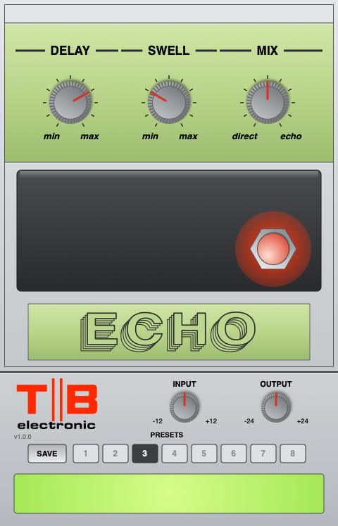

# TB Carls Echo (2026 Mac)

The TB Carls Echo for current Macs: **CLAP, VST3 and AU**, universal (Apple Silicon
and Intel), **macOS 11 and later**. Use it in Reaper, FL Studio, Logic, GarageBand,
Tape16 and other hosts.

The sound and panel are the same as the Mac OS X 10.8 VST build
([TB-Carls-Echo](https://github.com/tonybuzzcock/TB-Carls-Echo), v1.0.2, checked against
the real pedal). The DSP code is the same, and the test suite checks that the plugin's
output matches it sample for sample. It's a model of the Carlsbro Echo analogue delay,
built from Dirk Hendrik's schematic (`Docs/`). Personal, non-commercial use.

## Install

GitHub → Actions → latest run → Artifacts → `TB-Carls-Echo-mac`, unzip, then follow
`INSTALL.txt`. In short:

- `TB Carls Echo.vst3` → `VST3/`
- `TB Carls Echo.component` → `Components/`
- `TB Carls Echo.clap` → `CLAP/`

These folders are in `/Library/Audio/Plug-Ins/` (the main Library) or
`~/Library/Audio/Plug-Ins/` (your user Library). Use whichever one your other plugins
are in. Apple hasn't notarised the plugins, so run the short Terminal lines in
`INSTALL.txt` for the folder you used. They clear macOS's download tags and re-sign the
plugins on your Mac. Then rescan plugins in your DAW.

## Controls

| Name | Control | Range |
|------|---------|-------|
| Delay | VR1, 47K log dual: the CCD clock and the tone filter | 16 – 183 ms (min/max on the panel) |
| Swell | VR2, the repeats | 0 – 10 (min/max on the panel) |
| Mix | VR3, direct to echo | 0 – 10 (direct/echo on the panel) |
| Effect | the stomp switch: effect in, or the buffered dry signal | In / Out |
| Input | *plugin only*: level into the pedal (1.0 = 1 V) | ±12 dB |
| Output | *plugin only*: output trim | ±24 dB |

Defaults follow the photo of the pedal: Delay 7, Swell 3, Mix 5. In stereo, each side
runs through its own copy of the circuit with the same settings; a mono source is
processed once.

## The panel

480 × 748 portrait, on the TB Suzz layout in the pedal's green: DELAY, SWELL and MIX,
the charcoal treadle with the stomp switch on the right as on the pedal (glows red with
the effect in), and the name plate with ECHO in stacked outline lettering (drawn in
code). The strip along the bottom has the TB electronic logo with the build version,
Input, Output, presets and the readout.

Drag a knob up or down to turn it (hold Shift for fine control). Double-click a knob
to reset it, or use the scroll wheel. Click the stomp switch to switch the effect in
or out.

**Presets:** click SAVE, then a slot 1–8. Click a saved slot to recall it. The presets
are shared by all three formats, in
`~/Library/Application Support/TB/TB Carls Echo/Presets.txt`.

## What's modelled

An NE571 compander around a Reticon R5101 CCD, with the Sallen-Key and 3rd-order
filters either side, the VR1.B tone filter that darkens long delays, the SWELL feedback
into the compressor, MIX and the buffered bypass. The NE571s are gain cells driven by
their own rectifiers, and the CCD is a clocked sample-and-hold chain, so the compander's
breathing and the clock aliasing are there. 4x oversampled. See the 10.8 repo's README
for the estimates (CCD length and gain, clock law, NE571 level) and the reading of R13
as 2K2 rather than the drawn 22K.

## How it's built

The plugin is written once as a CLAP (`Source/Plugin`).
[clap-wrapper](https://github.com/free-audio/clap-wrapper) v0.17.0 builds the VST3 and
AU from that same code. The SDKs are downloaded at configure time:

    cmake -B build -DCMAKE_BUILD_TYPE=Release
    cmake --build build --config Release

GitHub Actions builds universal binaries and fails unless every plugin has both
architectures and a macOS 11.0 minimum. It ad-hoc signs the plugins, then:

- runs the DSP, preset and CLAP host tests (native and the other architecture)
- opens the panel offscreen through the CLAP GUI extension and drives its controls
- validates with auval (`aufx TBce TBel`), clap-validator and pluginval
- publishes panel screenshots to the `gui-preview` branch

A Linux job builds the CLAP and runs the same tests.
